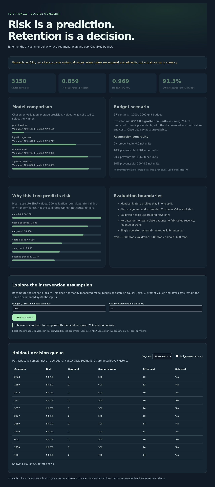

# RetentionLab

Budget-aware churn prediction and retention scenario planning. Built for a data
analyst portfolio: SQL features, statistics, model comparison, explainability,
a binary targeting optimizer and a local decision dashboard.



## Problem

Which customers appear likely to churn, and which contacts maximize expected net
value under a fixed budget? Prediction and intervention effectiveness are
separate questions. This project measures the first and simulates the second.
See [problem brief](docs/problem-brief.md) and [architecture](docs/architecture.svg).

## Measured results

Reproduced from `artifacts/results.json`, seed 42, fixed grouped split:

| Model | Validation AP | Holdout AP | Holdout ROC-AUC | Precision | Recall |
|---|---:|---:|---:|---:|---:|
| Prior baseline | 0.1406 | 0.1290 | 0.5000 | 0.1290 | 1.0000 |
| Logistic regression | 0.6182 | 0.7171 | 0.9277 | 0.5673 | 0.7375 |
| Random forest | 0.7938 | 0.8499 | 0.9695 | 0.6804 | 0.8250 |
| XGBoost, selected | 0.8362 | 0.8592 | 0.9694 | 0.6195 | 0.8750 |

Average precision (AP) on validation chooses the model; validation F1 sets each
threshold. Holdout contains 620 customers and 80 churners. Top 20% risk contains
73 of those churners (91.25%). Random forest has better holdout F1 than the
selected XGBoost (0.7458 vs 0.7254); the winner was not reselected after seeing
holdout. Scores describe this sample, not future business performance.

The optimizer selects 97 contacts with exactly 1,000 **hypothetical monetary
units** of budget, producing 6,362.8 expected net scenario units under these
assumptions: 20% of predicted churn is preventable, value = 500 + 100 × charge
band, contact cost = 10 + 2 × charge band. These are invented scenario inputs,
not observed revenue or INR/USD. At zero intervention effect it selects nobody.
**Observed savings: unavailable. Causal uplift: not estimated.**

## Run locally

Python 3.10 was used. No paid account, cloud or API key is needed.

```sh
python -m venv .venv
. .venv/bin/activate
pip install -r requirements.txt
# Pinned source CSV is included under its CC BY 4.0 license.
# Optional checksum-verified refresh:
python scripts/download_data.py
PYTHONPATH=src python -m retentionlab.pipeline
PYTHONPATH=src python -m unittest discover -s tests -v
python -m http.server 8770 --bind 127.0.0.1
# Open http://127.0.0.1:8770/dashboard/
```

The custom HTML dashboard reads generated JSON locally, with segment and budget
filters. It is not Power BI or Tableau. No public deployment, Databricks run,
Azure Data Factory integration or demo video has been completed.

## Pipeline and safeguards

- UCI CSV -> SQLite raw table -> CTE cleaning, tariff lookup join, ratios and
  `NTILE` window -> grouped train/validation/holdout.
- Source has 300 exact duplicate rows, and 365 repeated observable model-feature
  profiles. Identical feature profiles stay in the same outer split and inner
  calibration fold. Groups, split IDs and raw checksum are saved.
- Fixed 1,890/640/620 training/validation/holdout rows; no temporal split possible
  because individual timestamps are absent. No holdout hyperparameter search.
- Training-only scaling, class weights, grouped sigmoid calibration. Calibration
  is measured with Brier score, not assumed perfect.
- Training-only complaint chi-square and usage Welch t-test in results. These
  are exploratory associations, not causal hypotheses proven by this sample.
- SHAP explains a separate training-only random forest on 100 validation rows,
  not the selected calibrated ensemble. Correlated features limit attribution.
- K-Means segments fit on training rows only. Segment numbers are not validated
  customer personas. Contact actions need a randomized pilot, not blind rollout.
- SciPy/HiGHS binary MILP maximizes risk × assumed preventable fraction × assumed
  value minus cost, with contact-budget constraint. Tests compare to brute force.

## Data, license and limits

[UCI Iranian Churn](https://archive.ics.uci.edu/dataset/563/iranian+churn+dataset),
2020, DOI [10.24432/C5JW3Z](https://doi.org/10.24432/C5JW3Z), CC BY 4.0.
3,150 rows, one Iranian telecom operator. Inputs aggregate the first nine months;
churn is measured at month 12, with a three-month planning gap. Publisher charge
amount is ordinal, not currency. Status and undocumented Customer Value are
excluded to reduce leakage/interpretability risk; age fields are not predictors.
There is no transaction history to compute real RFM recency or monetary totals.
Generalization to retail, banking or India is untested. This is not a production
customer-contact system. No real customers were contacted.

Source downloads, references and transformation attribution: [data card](docs/data-card.md).

Optional browser smoke test: install `playwright-core` in a separate Node test
workspace, start the local server as above, set `NODE_PATH` to that workspace's
`node_modules`, then run `node tests/browser/smoke.cjs`. `CHROME_BIN` can override
the system Chrome path. The smoke checks both viewport sizes and dashboard
filters; screenshots are written to `/tmp`.
