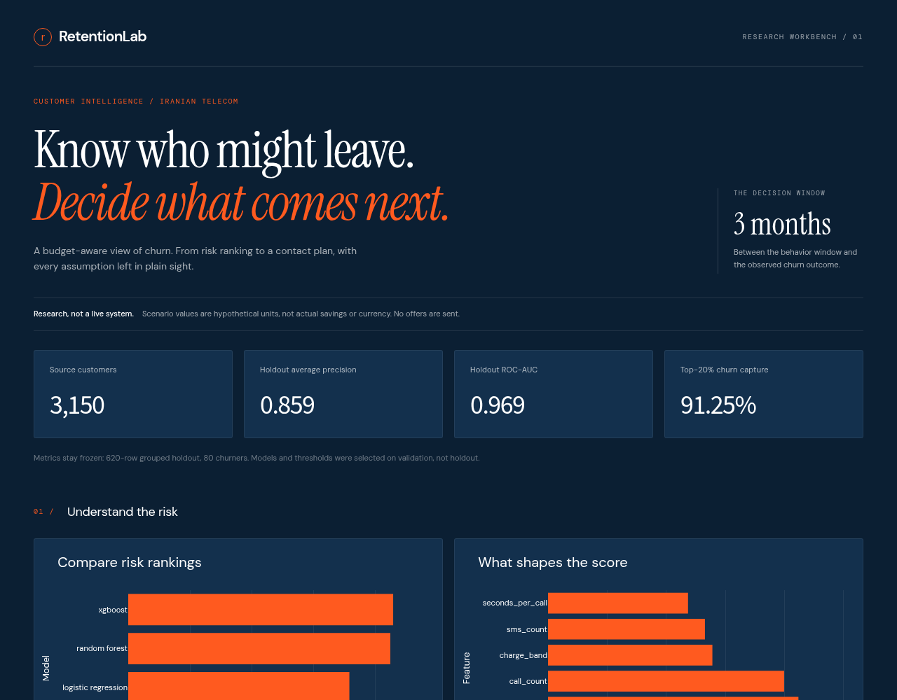

# RetentionLab

Budget-aware churn prediction and retention scenario planning. Built for a data
analyst portfolio: SQL features, statistics, model comparison, explainability,
a binary targeting optimizer and a local decision dashboard.



**Reviewer map:** [results](#measured-results) · [run](#start-here) ·
[architecture and decisions](docs/reviewer-guide.md) · [data card](docs/data-card.md) ·
[design notes](docs/design-notes.md).

## Problem

Which customers appear likely to churn, and which contacts maximize expected net
value under a fixed budget? Prediction and intervention effectiveness are
separate questions. This project measures the first and simulates the second.
See [problem brief](docs/problem-brief.md) and [architecture](docs/architecture.svg).

## Measured results

Reproduced from `artifacts/results.json`, seed 42, fixed grouped split:

| Model | Validation AP | Holdout AP | Holdout ROC-AUC | Precision | Recall |
|---|---:|---:|---:|---:|---:|
| Prior baseline | 0.1406 | 0.1290 | 0.5000 | 0.1290 | 1.0000 |
| Logistic regression | 0.6182 | 0.7171 | 0.9277 | 0.5673 | 0.7375 |
| Random forest | 0.7938 | 0.8499 | 0.9695 | 0.6804 | 0.8250 |
| XGBoost, selected | 0.8362 | 0.8592 | 0.9694 | 0.6195 | 0.8750 |

Average precision (AP) on validation chooses the model; validation F1 sets each
threshold. Holdout contains 620 customers and 80 churners. Top 20% risk contains
73 of those churners (91.25%). Random forest has better holdout F1 than the
selected XGBoost (0.7458 vs 0.7254); the winner was not reselected after seeing
holdout. Scores describe this sample, not future business performance.

The optimizer selects 97 contacts with exactly 1,000 **hypothetical monetary
units** of budget, producing 6,362.8 expected net scenario units under these
assumptions: 20% of predicted churn is preventable, value = 500 + 100 × charge
band, contact cost = 10 + 2 × charge band. These are invented scenario inputs,
not observed revenue or INR/USD. At zero intervention effect it selects nobody.
**Observed savings: unavailable. Causal uplift: not estimated.**

## Start here

Python 3.10, CPU only. No cloud account, provider key or paid service is needed.
The checked-in artifacts are sufficient to explore the dashboard. Training is a
separate, explicit command, not part of app startup.

```sh
python -m venv .venv
. .venv/bin/activate
python -m pip install -r requirements.txt
python scripts/verify_artifacts.py
streamlit run streamlit_app.py --server.address 127.0.0.1 --server.port 8780
# Open http://127.0.0.1:8780
```

### Reproduce and test

```sh
# Source data is pinned and attributed; download is optional.
python scripts/download_data.py
PYTHONPATH=src python -m retentionlab.pipeline
python scripts/verify_artifacts.py
PYTHONPATH=src python -m unittest discover -s tests -v
```

The verification command checks the versioned SHA-256 manifest and population
constraints before the app reads the evidence. It catches mixed/missing files;
it does not authenticate a dataset author or make a retrained model equivalent.
If a rerun differs, inspect the source checksum, dependency versions, split IDs
and generated diff. Do not replace the manifest merely to silence a failure.
Review and version any intentional new evidence separately, without selecting
against the existing holdout. See [reviewer guide](docs/reviewer-guide.md).

The primary UI is Streamlit + Plotly. Optional HTML fallback:
`python -m http.server 8770 --bind 127.0.0.1`, then `/dashboard/`.
Neither UI is Power BI or Tableau. Cloud deployment, Databricks, Azure Data
Factory and a demo video have not been completed.

## Pipeline and safeguards

- UCI CSV -> SQLite raw table -> CTE cleaning, tariff lookup join, ratios and
  `NTILE` window -> grouped train/validation/holdout.
- Source has 300 exact duplicate rows, and 365 repeated observable model-feature
  profiles. Identical feature profiles stay in the same outer split and inner
  calibration fold. Groups, split IDs and raw checksum are saved.
- Fixed 1,890/640/620 training/validation/holdout rows; no temporal split possible
  because individual timestamps are absent. No holdout hyperparameter search.
- Training-only scaling, class weights, grouped sigmoid calibration. Calibration
  is measured with Brier score, not assumed perfect.
- Training-only complaint chi-square and usage Welch t-test in results. These
  are exploratory associations, not causal hypotheses proven by this sample.
- SHAP explains a separate training-only random forest on 100 validation rows,
  not the selected calibrated ensemble. Correlated features limit attribution.
- K-Means segments fit on training rows only. Segment numbers are not validated
  customer personas. Contact actions need a randomized pilot, not blind rollout.
- SciPy/HiGHS binary MILP maximizes risk × assumed preventable fraction × assumed
  value minus cost, with contact-budget constraint. Tests compare to brute force.

## Data, license and limits

[UCI Iranian Churn](https://archive.ics.uci.edu/dataset/563/iranian+churn+dataset),
2020, DOI [10.24432/C5JW3Z](https://doi.org/10.24432/C5JW3Z), CC BY 4.0.
3,150 rows, one Iranian telecom operator. Inputs aggregate the first nine months;
churn is measured at month 12, with a three-month planning gap. Publisher charge
amount is ordinal, not currency. Status and undocumented Customer Value are
excluded to reduce leakage/interpretability risk; age fields are not predictors.
There is no transaction history to compute real RFM recency or monetary totals.
Generalization to retail, banking or India is untested. This is not a production
customer-contact system. No real customers were contacted.

Source downloads, references and transformation attribution: [data card](docs/data-card.md).

Optional browser smoke test: install `playwright-core` in a separate Node test
workspace, start the local server as above, set `NODE_PATH` to that workspace's
`node_modules`, then run `node tests/browser/smoke.cjs`. `CHROME_BIN` can override
the system Chrome path. The smoke checks both viewport sizes and dashboard
filters; screenshots are written to `/tmp`.

The dashboard also includes a local budget/preventable-churn scenario explorer.
Its exact integer-cost knapsack matches the pipeline MILP at the fixed benchmark
and selects no one when the assumed effect is zero. Test with
`node --test tests/browser/scenario.cjs`; browser interaction regression is
`node tests/browser/scenario-ui.cjs`. The explorer does not change model metrics
or contact anyone. Design choices: [notes](docs/design-notes.md).

## Primary Streamlit + Plotly dashboard

```sh
# From this repository root, after installing requirements.txt:
streamlit run streamlit_app.py --server.port 8780
# Open http://127.0.0.1:8780
```

The single page has four KPI cards, four charts (three Plotly + one Altair) and one filtered table (five
visuals excluding KPI cards). It uses the requested graphite/sage/ivory theme in
`.streamlit/config.toml`, with Plotly dark template and 20px chart titles. The
app reads the existing artifacts, never retrains or tunes the model. Interactive
filters and downloads do not change the frozen metrics. AppTest regression
checks are included in the Python test suite. Desktop and mobile rendering
were inspected. No Streamlit Cloud deployment or new remote service is active.

The original HTML dashboard instructions above remain valid as a fallback;
new Streamlit work does not claim to add Power BI, Tableau or expert labels.

### Dashboard design

The Streamlit workbench uses an editorial header, Instrument Serif display type,
DM Sans interface type and DM Mono metadata, bundled as local embedded fonts under
their SIL Open Font Licenses (see `assets/fonts/`). No external font request or
paid design asset is required. Graphite, sage and ivory now form the base palette.
KPI cards form a four-column desktop strip and two-column mobile grid; chart
surfaces, form controls, tables and section dividers share the same spacing.
A short header entrance respects reduced-motion settings. All four KPI values,
four charts (three Plotly + one Altair), filters, scenario controls and evidence limits remain in the page.

Design references, used for direction rather than copied templates:
[Landdding](https://landdding.com), [Godly](https://godly.website),
[Recent](https://recent.design), [Font In Logo](https://fontinlogo.com), and
[Footer Design](https://footer.design). The interface is an original local
implementation, not an endorsement or a purchased template.

## Checks and change policy

Run the evidence verification and Python test commands above before changing
presentation. A hosted CI workflow is not installed in this checkpoint: the
current GitHub token cannot write workflow files. No deployment workflow is
added. Intentional evidence updates need a reviewed artifact diff, source/split
provenance and a separate evaluation decision. Presentation changes should not
change data/model files or the metrics they display.

## Power BI Desktop kit and UI helpers

[Power BI build guide](powerbi/BUILD_GUIDE.md), [data dictionary](powerbi/DATA_DICTIONARY.md)
and the CSV/theme exports are in `powerbi/`. This is an import/build kit for
Windows, not an already built or visually verified `.pbix` report. No Power BI
service publishing or scheduled refresh is configured. Recreate verified exports
with `python scripts/export_powerbi.py`. The same graphite/sage/ivory palette is
used in the local Streamlit dashboard and the Power BI theme.

The local app uses `streamlit-extras.metric_cards` for cards and
`streamlit-option-menu` for a real queue view/order control. Plotly remains
primary; one Altair chart adds a consistent declarative chart surface. There is
no Dash layer, no decorative sidebar and no new data/metric claim. The extras
package has optional component dependencies; only metric styling is used here.


### Required evidence coverage

Dashboard verification and cache fingerprinting now require the manifest to name
every artifact the dashboard consumes. Removing a metric file from the manifest
can no longer make an unverified file appear checked. Manifest containers and
SHA-256 values are validated before reading files. Two synthetic regressions
cover omitted required files and malformed manifests. Frozen artifacts, splits,
metrics and Power BI exports are unchanged. This checks accidental bundle mixing,
not authenticity against an actor who can replace both source and manifest.


### Optimizer output checks

A solver success flag is no longer enough to display a target plan: its returned
vector must have the expected length, finite binary entries and a feasible budget.
Non-finite scenario objectives are rejected before solving. Solver failures return
a fixed no-plan message rather than raw solver details. Two synthetic regressions
exercise invalid success vectors and failure paths. Frozen risk scores, evaluation
metrics and the hypothetical preventable-fraction assumption remain unchanged;
this does not turn scenario value into measured causal savings.
